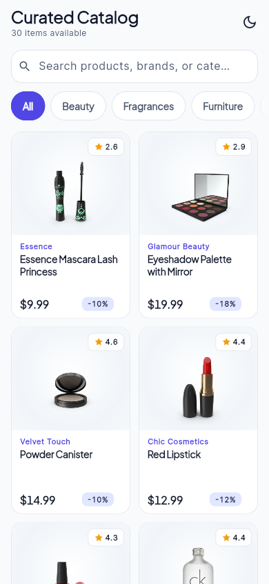
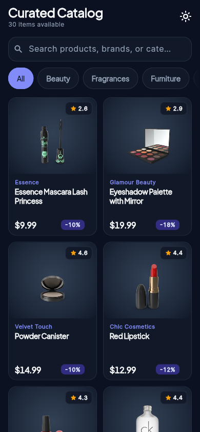
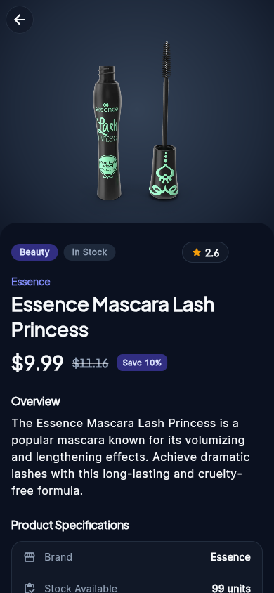

# Product Catalog

A Flutter product catalog application built with clean architecture and `flutter_bloc`. It loads items from the DummyJSON API, supports debounced search and category filtering, toggles Light/Dark themes, and opens a details screen with a `Hero` image transition.

## Screenshots

| Light Mode | Dark Mode | Product Details |
| :---: | :---: | :---: |
|  |  |  |

## Features

- **Product Catalog:** Responsive grid with studio-lit image backdrops, rating badges, discounts, and Light/Dark Material 3 theme switching.
- **Search & Category Filters:** Real-time search (`300ms` debounce) combined with horizontal category filter chips and a one-tap **Reset Filters** empty state.
- **Loading & Error States:** Pulsing skeleton grid while loading, and an offline/error view with a **Try Again** button when requests fail.
- **Product Details:** Expandable `SliverAppBar` with a `Hero` image transition, pricing breakdown, description, specification rows, and tags.

## Getting Started

### Prerequisites

- Flutter `3.24.4` (Dart `3.5+`)
- For Android builds: Android Studio / JDK 17 or 21 (configured in `android/settings.gradle` with AGP `8.3.2` and Gradle `8.7`)

### Run Locally

```bash
flutter pub get
flutter run
```

To point the app at a different HTTPS backend host:

```bash
flutter run --dart-define=API_BASE_URL=https://dummyjson.com
```

### Static Analysis & Tests

```bash
flutter analyze
flutter test
```

GitHub Actions (`.github/workflows/ci.yml`) runs `flutter pub get`, `flutter analyze`, and `flutter test` on every push and pull request to `main`.

## Project Structure

```text
lib/
├── main.dart                     # Dependency setup and app entry point
├── app.dart                      # MaterialApp, ThemeMode, and BlocProviders
├── core/
│   ├── constants/                # Base URL config, timeouts, search limits
│   ├── error/                    # Data exceptions and sealed Failure types
│   ├── network/                  # ApiClient (HTTPS enforcement + 10s timeout)
│   ├── theme/                    # Light/Dark themes, spacing, radius, ThemeCubit
│   └── utils/                    # Search query sanitizer and HTTPS URL validator
└── features/
    └── catalog/
        ├── domain/               # Product entity and CatalogRepository interface
        ├── data/                 # ProductModel DTO, remote data source, repo impl
        └── presentation/         # CatalogBloc, CatalogPage, ProductDetailsPage, widgets
test/
└── features/catalog/
    ├── data/models/product_model_test.dart
    └── presentation/
        ├── bloc/catalog_bloc_test.dart
        └── pages/catalog_audit_widget_test.dart
```

## Architecture & Implementation Notes

- **Data Flow:** `UI (Pages & Widgets) -> CatalogBloc -> CatalogRepository -> CatalogRemoteDataSource -> ApiClient`. UI widgets contain no HTTP calls, filtering logic, or JSON parsing.
- **Fast Image Loading:** The catalog grid uses a lazy `SliverGrid` (`cacheExtent: 500`) instead of eagerly mounting all off-screen cards, so visible products download first. `SafeNetworkImage` skips placeholder flashes when an image is already in memory (`wasSynchronouslyLoaded`), and `ProductDetailsPage` reuses the cached thumbnail URL so the `Hero` transition renders immediately without waiting on a second download.
- **Concurrency & Debouncing:** `CatalogBloc` debounces search queries (`300ms`) with a latest-request-wins `EventTransformer` and cancels the active debounce timer inside `CatalogFiltersReset` and `close()` so stale searches cannot overwrite a reset.
- **Error Handling & Security:** `ApiClient` builds URLs via `Uri.https(...)` with a `10s` timeout. `ProductModel.fromJson` validates types without `dynamic`. `CatalogRepositoryImpl` maps transport and parsing exceptions to sealed `Failure` classes so raw stack traces never surface in the UI. On Android, `AndroidManifest.xml` sets `android:usesCleartextTraffic="false"`.
- **Accessibility & Test Coverage (15 tests):** Grid aspect ratios, filter chip heights, and `SliverAppBar` heights scale with `MediaQuery.textScalerOf(context)`. Tests cover DTO validation (5 tests), bloc filtering and race conditions (7 tests), and `1.3x` text-scale / offline-retry widget audits (3 tests).
